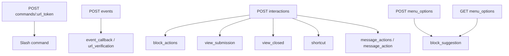

# grape-slack-bot.rb

[](https://badge.fury.io/rb/grape-slack-bot) [](https://github.com/amkisko/grape-slack-bot.rb/actions/workflows/test.yml)

Extensible Slack bot implementation gem for [ruby-grape](https://github.com/ruby-grape/grape) with support for slash commands, interactive components, events, and views.

Sponsored by [Kisko Labs](https://www.kiskolabs.com).

<a href="https://www.kiskolabs.com">
  
</a>

## Installation

Add to your Gemfile:

```ruby
gem "grape-slack-bot"
```

Run `bundle install` or `gem install grape-slack-bot`.

## Integration with Other Gems

This gem works seamlessly with other gems in the ecosystem:

- **[grape-rails-logger](https://github.com/amkisko/grape-rails-logger.rb)**: Automatically logs all Slack bot requests with structured logging, including request metadata, performance metrics, and parameter filtering. Works automatically when included in your Grape API.

- **[activesupport-json_logging](https://github.com/amkisko/activesupport-json_logging.rb)**: Provides structured JSON logging for Rails applications. When used together, all Slack bot interactions are logged in JSON format, making it easy to parse and analyze logs.

Example setup with both gems:

```ruby
# config/initializers/json_logging.rb
Rails.application.configure do
  base_logger = ActiveSupport::Logger.new($stdout)
  json_logger = JsonLogging.new(base_logger)
  config.logger = json_logger
end

# app/api/slack_bot_api.rb
class SlackBotApi < Grape::API
  include SlackBot::GrapeExtension
  # grape-rails-logger automatically instruments requests
end
```

## Usage

Create `app/api/slack_bot_api.rb`, it will contain bot configuration and endpoints setup:

```ruby
SlackBot::DevConsole.logger = Rails.logger
SlackBot::DevConsole.enabled = Rails.env.development?
SlackBot::Config.configure do
  callback_storage Rails.cache
  callback_user_finder ->(id) { User.active.find_by(id: id) }
  user_session_resolver ->(team_id, user_id) do
    uid = OmniAuth::Strategies::SlackOpenid.generate_uid(team_id, user_id)
    UserSession.find_by(uid: uid, provider: UserSession.slack_openid_provider)
  end
  event_dispatcher ->(handler:, params:, current_user:) do
    SlackEventJob.perform_later(handler.name, params.deep_stringify_keys, current_user&.id)
  end

  # Register event handlers
  event :app_home_opened, MySlackBot::AppHomeOpenedEvent
  interaction MySlackBot::AppHomeInteraction
  block_action :approve_request, MySlackBot::ApproveRequestInteraction

  # Register slash command handlers
  slash_command_endpoint :game, MySlackBot::Game::MenuCommand do
    command :start, MySlackBot::Game::StartCommand
  end
end

class SlackBotApi < Grape::API
  include SlackBot::GrapeExtension

  helpers do
    def config
      SlackBot::Config.current_instance
    end

    def current_user_session
      # NOTE: fetch_team_id and fetch_user_id are provided by SlackBot::GrapeHelpers
      @current_user_session ||=
        resolve_user_session(fetch_team_id, fetch_user_id)
    end

    def current_user_ip
      request.env["action_dispatch.remote_ip"].to_s
    end

    def current_user
      @current_user ||= current_user_session&.user
    end
  end
end
```

In routes file `config/routes.rb` mount the API:

```ruby
mount SlackBotApi => "/api/slack"
```

## Slack Schema

Use `SlackBot::Schema` to define handlers in separate classes and share
registrations across bots. Install it with `use` inside `Config.configure`.
Existing Config registrations and handlers using `call` can coexist with Schema
handlers.

```ruby
class StartInput < SlackBot::Schema::InputObject
  argument :name, String, required: true
  argument :rounds, Integer, default: 1
end

class StartGame < SlackBot::Schema::SlashCommand
  input StartInput

  def resolve(name:, rounds:)
    {response_type: "ephemeral", text: "#{name}: #{rounds} rounds"}
  end
end

class GameMenu < SlackBot::Schema::SlashCommand
  def resolve
    {response_type: "ephemeral", text: "Try /game start name=quiz&rounds=3"}
  end
end

class GameCommands < SlackBot::Schema::SlashCommandGroup
  default_command GameMenu
  command :start, StartGame
end

class GameSchema < SlackBot::Schema
  slash_command :game, GameCommands
end

class BotSchema < SlackBot::Schema
  mount GameSchema
end

SlackBot::Config.configure do
  use BotSchema
end
```

Input objects read the command's existing query-string format. Arguments
can use `String`, `Integer`, `Float`, or a callable that receives the raw
value. Declare `required: true` for required arguments and `default:` for a
typed default. Slash handlers inherit the existing user, workspace, and
direct-message checks.

### Supported Slack HTTP requests



| Payload | Registration | Schema handler |
| --- | --- | --- |
| Slash command | `slash_command :url_token, Handler` | `SlashCommand` or `SlashCommandGroup` |
| `event_callback` | `event :type, Handler` | `Event` |
| `url_verification` | Handled by the Events endpoint | |
| `block_actions` | `block_actions :action_id, Handler` for messages and unscoped App Home views. Declare `block_actions Handler` on a scoped view owner. | `BlockActions` |
| `view_submission` | Declare `view_submission Handler` on the view owner | `ViewSubmission` |
| `view_closed` | Declare `view_closed Handler` on the owner or register `view_closed :callback_id, Handler` for externally opened views | `ViewClosed` |
| `shortcut` | `shortcut :callback_id, Handler` | `Shortcut` |
| `message_action` or `message_actions` | `message_action :callback_id, Handler` | `MessageAction` |
| `block_suggestion` | `block_suggestion :action_id, Handler` or `options :action_id, Handler` | `Options` |

Set Slack's **Options Load URL** to the existing mounted `/menu_options`
endpoint. Slack sends a form-encoded POST with a `payload` containing
`type: "block_suggestion"`, `action_id`, and `value`. Return `{options: [...]}`
or `{option_groups: [...]}`. Existing `menu_options` registrations continue
to accept GET calls with `action_id` and `value` in the query string.
See the [Slack interaction payload reference](https://docs.slack.dev/reference/interaction-payloads/)
and [Options Load payload reference](https://docs.slack.dev/reference/interaction-payloads/block_suggestion-payload/).

### Actions and responses

Declare `view ViewClass` on a handler to render views. A slash command,
event, shortcut, or block action can declare the view's `block_actions`,
`view_submission`, and `view_closed` handlers. Set `notify_on_close: true`
in a modal to receive a close payload. Configure `callback_storage` and
`user_session_resolver` for scoped views, and declare named owner classes so
their callbacks can route after a process restart.

```ruby
class EditSubmission < SlackBot::Schema::ViewSubmission
  respond_with response_action: :clear

  def resolve
    name = view_state(:name_block, :name_input)
    return {errors: {name_block: "Enter a name"}} if name.to_s.empty?

    nil
  end
end

class EditShortcut < SlackBot::Schema::Shortcut
  view TicketView
  view_submission EditSubmission
  respond_with open_modal: :edit_modal
end
```

| Declaration | Result |
| --- | --- |
| `respond_with open_modal: :edit_modal` | Call `views.open` using the trigger |
| `respond_with update_modal: :edit_modal` | Call `views.update` using the current view ID and its hash when supplied |
| `respond_with push_modal: :details_modal` | Call `views.push` using the trigger |
| `respond_with publish_view: :home` | Call `views.publish` for the Slack user |
| `respond_with response_action: :update, view: :edit_modal` | Return replacement view JSON on submission |
| `respond_with response_action: :push, view: :details_modal` | Return a new view on submission |
| `respond_with response_action: :clear` | Clear the modal stack on submission |
| `respond_with response_action: :errors` | Use the resolver's `{errors: {block_id => message}}` for field errors |
| `respond_with response_url: :ephemeral, text: "Saved", blocks: :confirmation` | Send text and rendered message blocks to Slack |
| `respond_with response_url: :in_channel, replace_original: true, text: "Saved"` | Replace the source message |
| `respond_with delete_original: true` | Delete the source message |
| `respond_with :ack` or `respond_with :none` | Acknowledge, or let the resolver return its own response |

A hash from `resolve` overrides a declaration. In a submission, an
`errors:` hash becomes a Slack validation response. Return `:halt` to
acknowledge immediately and skip the declared response. A submission with
one `response_urls` entry can use it for declarative replies. For multiple
entries, choose the destination in `resolve` and use
`SlackBot::ApiClient.response_url_post(url, **message)`. The instance
method of the same name is also available.

On a `BlockActions` handler, `action :pick, args: {user_id: :selected_user}`
calls `pick(user_id:)` when Slack sends that action ID. Use `with: :method`
to select another method, or `with: ServiceClass` to instantiate it with
the extracted keyword arguments and call it. Extractors can use Slack
field names, `:selected_option_value`, `:selected_option_values`, or a
callable that receives the action hash. Override `resolve` to control
dispatch explicitly and call `super` to run the declared actions.
On a submission, `view_state` returns the full state map, one block's
state, or the submitted value at a block and action ID.

See [Slack acknowledgements and message responses](https://docs.slack.dev/interactivity/handling-user-interaction/)
and [Slack modals](https://docs.slack.dev/surfaces/modals/) for response
mechanisms and timing. See [RFC-0002](rfcs/0002-slack-schema.md) for the
Schema contract and scope.

## Concepts

### Slash command

Slash command is a command that is triggered by user in Slack chat using `/` prefix.

Characteristics:
- Can have multiple URL endpoints (later called `url_token`, e.g. `/api/slack/commands/game`)
- Starts with `/` and is followed by command name (e.g. `/game`, called `token`)
- Can have multiple argument commands (e.g. `/game start`, called `token`)
- Can have multiple arguments (e.g. `/game start password=P@5sW0Rd`, called `args`)
- Can send message to chat
- Can open interactive component with callback identifier
- Can trigger event in background

References:
- [Slash command documentation](https://api.slack.com/interactivity/slash-commands)

### Interactive component

Interactive component is a component that is requested to be opened by bot app for the user in Slack application.

Characteristics:
- Can be associated with slash command
- Can be associated with event

References:
- [Interactive components documentation](https://api.slack.com/interactivity/handling)

### Event

Event is a notification that is sent to bot app when something happens in Slack.

References:
- [Event documentation](https://api.slack.com/events-api)

### View

View is a class that has logic for rendering internals of message or modal or any other user interface component.

Characteristics:
- Can be associated with slash command, interactive component or event for using ready-made methods like `open_modal`, `update_modal` or `publish_view`

References:
- [App home documentation](https://api.slack.com/surfaces/app-home)
- [Messages documentation](https://api.slack.com/messaging)
- [Modals documentation](https://api.slack.com/surfaces/modals)

### Block

Block is an object that is used to render user interface elements in Slack.

References:
- [Block kit documentation](https://api.slack.com/block-kit)

### Callback

Callback is a class for managing interactive component state and handling interactive component actions.

Example uses `Rails.cache` for storing interactive component state, use `CallbackStorage` for building custom storage class as a base.

### Arguments

Class for handling slash command and interactive element values as queries.

Gem implementation uses `Rack::Utils` for parsing and building query strings.

### Pager

Own implementation of pagination that is relying on [Arguments](#arguments) and [ActiveRecord](https://guides.rubyonrails.org/active_record_querying.html).

## Features

- Create any amount of endpoints that will handle Slack calls
- Create multiple instances of bots and configure them separately or use the same configuration for all bots
- Define and reuse slash command handlers for Slack slash commands
- Define interactive component handlers for Slack interactive components
- Define and reuse views for slash commands, interactive components and events
- Define event handlers for Slack events
- Define menu options handlers for Slack menu options
- Store interactive component state in cache for usage in other handlers
- Access current user session and user from any handler
- Extend API endpoint with custom hooks and helpers within [grape specification](https://github.com/ruby-grape/grape)
- Supports Slack signature verification with timestamp validation (replay attack protection)
- Automatic error handling for network failures and malformed payloads

## Slack bot manifest

You can use this manifest as a template for your Slack app configuration:

```yaml
display_information:
  name: Example
  description: Example bot
  background_color: "#000000"
features:
  bot_user:
    display_name: Example
    always_online: true
  slash_commands:
    - command: /game
      url: https://bot.rails.fi/api/slack/commands/game
      description: The game
      should_escape: false
oauth_config:
  redirect_urls:
    - https://example.com/user/auth/slack_openid/callback
  scopes:
    bot:
      - incoming-webhook
      - app_mentions:read
      - chat:write
      - users:read
      - users:read.email
      - im:read
      - im:write
      - im:history
      - channels:read
      - groups:read
      - mpim:read
      - reactions:read
      - commands
settings:
  event_subscriptions:
    request_url: https://bot.rails.fi/api/slack/events
    bot_events:
      - app_home_opened
      - app_mention
      - im_history_changed
      - member_joined_channel
      - member_left_channel
      - message.im
      - profile_opened
      - reaction_added
      - reaction_removed
  interactivity:
    is_enabled: true
    request_url: https://bot.rails.fi/api/slack/interactions
    message_menu_options_url: https://bot.rails.fi/api/slack/menu_options
  org_deploy_enabled: false
  socket_mode_enabled: false
  token_rotation_enabled: false
```

## Examples

### Command example

```ruby
module MySlackBot::Game
  class MenuCommand < SlackBot::Command
    interaction MySlackBot::Game::MenuInteraction
    view MySlackBot::Game::MenuView
    def call
      open_modal :index_modal
    end
  end
  class StartCommand < SlackBot::Command
    interaction MySlackBot::Game::StartInteraction
    view MySlackBot::Game::StartView
    def call
      open_modal :index_modal
    end
  end
end
```

### Interaction example

```ruby
module MySlackBot::Game
  class StartInteraction < SlackBot::Interaction
    view MySlackBot::Game::StartView
    def call
      return if interaction_type != "block_actions"

      update_callback_args do |action|
        action_id = action["action_id"]
        action_type = action["type"]
        case action_type
        when "static_select"
          if action_id == "games_users_list_select_user"
            callback.args[:user_id] = action["selected_option"]["value"]
          end
        else
          callback.args.raw_args = action["value"]
        end
      end

      update_modal :index_modal
    end
  end
end
```

### App home interaction example

```ruby
module MySlackBot
  class AppHomeInteraction < SlackBot::Event
    view MySlackBot::AppHomeView

    def call
      action_id = payload.dig("actions", 0, "action_id")
      case action_id
      when "add_game"
        add_game
      end
    end

    private

    def add_game
      open_modal :add_game_modal
    end
  end
end
```

### View example

Modal view example:

```ruby
module MySlackBot::Game
  class MenuView < SlackBot::View
    def index_modal
      blocks = []

      blocks << {
        type: "section",
        block_id: "section_help_list",
        text: {
          type: "mrkdwn",
          text: "#{command} start - Start the game"
        }
      }

      cursor = Game.active
      pager = paginate(cursor)

      blocks << {
        type: "section",
        block_id: "section_games_list",
        text: {
          type: "mrkdwn",
          text: "*Games*"
        }
      }

      if pager.cursor.present?
        pager.cursor.find_each do |game|
          blocks << {
            type: "section",
            block_id: "section_game_#{game.id}",
            text: {
              type: "mrkdwn",
              text: "#{game.name}"
            },
            accessory: {
              type: "button",
              action_id: "games_users_list_join_game",
              text: {
                type: "plain_text",
                text: "Join"
              },
              value: args.merge(game_id: game.id).to_s
            }
          }
        end
      else
        blocks << {
          type: "section",
          block_id: "section_games_list_empty",
          text: {
            type: "mrkdwn",
            text: "No active games"
          }
        }
      end

      if pager.pages_count > 1
        pager_elements = []
        if pager.page > 1
          pager_elements << {
            type: "button",
            action_id: "games_list_previous_page",
            text: {
              type: "plain_text",
              text: ":arrow_left: Previous page"
            },
            value: args.merge(page: pager.page - 1).to_s
          }
        end
        if pager.page < pager.pages_count
          pager_elements << {
            type: "button",
            action_id: "games_list_next_page",
            text: {
              type: "plain_text",
              text: "Next page :arrow_right:"
            },
            value: args.merge(page: pager.page + 1).to_s
          }
        end
        if pager_elements.present?
          blocks << {
            type: "actions",
            elements: pager_elements
          }
        end
      end

      {
        title: {
          type: "plain_text",
          text: "Example help"
        },
        blocks: blocks
      }
    end
  end
end
```

App home view example:

```ruby
module MySlackBot
  class AppHomeView < SlackBot::View
    def index_view
      blocks = []
      if current_user.present?
        blocks << {
          type: "section",
          text: {
            type: "mrkdwn",
            text: "*Hello, #{current_user.name}!*"
          }
        }
      else
        blocks << {
          type: "section",
          text: {
            type: "mrkdwn",
            text: "*Please login at https://example.com using Slack*"
          }
        }
      end
      blocks << {
        type: "context",
        elements: [
          {
            type: "mrkdwn",
            text: "Last updated at #{Time.current.strftime("%H:%M:%S %d.%m.%Y")}"
          }
        ]
      }
      { type: "home", blocks: blocks }
    end

    private

    def format_date(date)
      date.strftime("%d.%m.%Y")
    end
  end
end
```

### Event example

```ruby
module MySlackBot
  class AppHomeOpenedEvent < SlackBot::Event
    view MySlackBot::AppHomeView
    def call
      # NOTE: we have to create callback here in order to handle interactions
      self.callback = SlackBot::Callback.find_or_create(
        id: "app_home_opened",
        user: current_user,
        class_name: self.class.name
      )

      publish_view :index_view
    end
  end
end
```

## Security

The gem implements Slack's signature verification with the following security features:

- **Signature verification**: Validates requests using HMAC-SHA256 signature
- **Timestamp validation**: Rejects requests older than 5 minutes to prevent replay attacks
- **Secure comparison**: Uses `ActiveSupport::SecurityUtils.secure_compare` to prevent timing attacks

## Compatibility

- Grape >= 1.6, < 3.0
- Rails >= 5.0 (for ActionDispatch::RemoteIp)
- Ruby >= 3.0
- ActiveSupport >= 5.0

## Development

```sh
bundle install
bundle exec polyrun hook run before_suite
bundle exec polyrun parallel-rspec --workers 1 --merge-failures
```

To generate a local coverage report with Polyrun:

```sh
POLYRUN_COVERAGE=1 bundle exec polyrun parallel-rspec --workers 1 --merge-failures
```

For development and testing purposes you can use [Cloudflare Argo Tunnel](https://developers.cloudflare.com/cloudflare-one/connections/connect-apps) to expose your local development environment to the internet.

```sh
brew install cloudflare/cloudflare/cloudflared
cloudflared login
sudo cloudflared tunnel run --token <LONG_TOKEN_FROM_TUNNEL_PAGE>
```

For easiness of getting information, most of endpoints have `SlackBot::DevConsole.log` calls that will print out information to the console.

### Code Quality

The gem uses a StandardRB-compatible RuboCop configuration for consistent code style, with Polyrun orchestrating the lint and type-check hooks. Run `bundle exec polyrun hook run before_suite` to execute the configured checks.

The gem includes [RBS](https://github.com/ruby/rbs) type signatures in the `sig/` directory for better type checking and IDE support. Type signatures are included in the gem package.

## Contributing

Bug reports and pull requests are welcome on GitHub at https://github.com/amkisko/grape-slack-bot.rb

Contribution policy:
- New features are not necessarily added to the gem
- Pull request should have test coverage for affected parts
- Pull request should have changelog entry

Review policy:
- It might take up to 2 calendar weeks to review and merge critical fixes
- It might take up to 6 calendar months to review and merge pull request
- It might take up to 1 calendar year to review an issue

## Publishing

```sh
rm grape-slack-bot-*.gem
gem build grape-slack-bot.gemspec
gem push grape-slack-bot-*.gem
```

Or use the release script:

```sh
usr/bin/release.rb
```

## Links

- [GitHub](https://github.com/amkisko/grape-slack-bot.rb)
- [GitLab](https://gitlab.com/amkisko/grape-slack-bot.rb)
- [RubyGems](https://rubygems.org/gems/grape-slack-bot)
- [libraries.io](https://libraries.io/rubygems/grape-slack-bot)
- [Deps.dev](https://deps.dev/rubygems/grape-slack-bot)
- [SonarCloud](https://sonarcloud.io/project/overview?id=amkisko_grape-slack-bot.rb)
- [Snyk](https://snyk.io/test/github/amkisko/grape-slack-bot.rb)
- [Codecov](https://app.codecov.io/github/amkisko/grape-slack-bot.rb)
- [OpenSSF Scorecard](https://scorecard.dev/viewer/?uri=github.com/amkisko/grape-slack-bot.rb)

## License

The gem is available as open source under the terms of the [MIT License](https://opensource.org/licenses/MIT).
