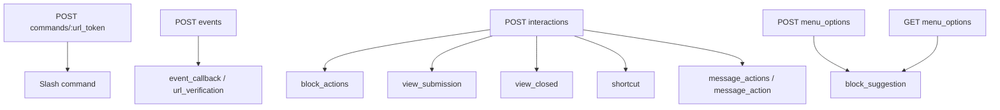

# RFC-0002 Slack Schema

- Type: Standards Track
- Status: Proposed
- Created: 2026-11-18
- Author: Codex
- Relates: RFC-0001

## Summary

Add an opt-in class-based Schema for classic Slack HTTP apps. Use Slack payload
types as registration names and compose handlers from separate Ruby classes.

## Motivation

Applications can register typed handlers and declare their responses without
writing transport dispatch for each handler. The current Config and `call`
entry points remain available.

## Guide-level explanation

Register the Schema with `config.use(AppSchema)`. Use `mount` inside a Schema
to share a group of registrations. Slash groups declare a default handler and
named subcommands. View owners declare separate block, submit, and close
handlers.

## Reference-level explanation

| Ingress | Registration or view route | Response |
| --- | --- | --- |
| Slash command | `slash_command` | Handler result or empty ACK |
| `event_callback` | `event`, keyed by event type | Handler result or empty ACK |
| `url_verification` | Transport | Challenge JSON |
| `block_actions` | `block_actions`, keyed by action ID for messages or by owner for views | Empty ACK or handler result |
| `view_submission` | Owner's `view_submission` | Empty ACK or `response_action` JSON |
| `view_closed` | Owner's `view_closed`, or `view_closed` keyed by Slack callback ID for externally opened views | Empty ACK or handler result |
| `shortcut` | `shortcut`, keyed by callback ID | Empty ACK or handler result |
| `message_actions` / `message_action` | `message_action`, keyed by callback ID | Empty ACK or handler result |
| `block_suggestion` | `block_suggestion` or `options`, keyed by action ID | Options or option groups JSON |

`respond_with` declares `open_modal`, `update_modal`, `push_modal`,
`publish_view`, `response_action`, or a message via `response_url`.
`:ack`, `:none`, and a `:halt` result produce an empty acknowledgement.
A hash returned by `resolve` takes precedence over the declaration. Submission
`errors:` hashes become Slack validation error responses. `action` routes
matching block actions by ID and extracts keyword arguments. `view_state`
reads Slack's submitted values. Slash input objects declare keyword coercion.

Existing Config and legacy handler classes remain usable. The Options Load URL
also accepts the existing GET API. Signing and mount prefixes are shared with
the existing resources. Scoped callbacks require a matching application user.

## Drawbacks

Views API calls made during request handling consume part of Slack's
acknowledgement window. View callbacks need an application session and callback
storage. Slack's native limits apply to options, modal depth, and response URLs.

## Rationale and alternatives

Typed handlers give each interaction a separate class and retain the existing
Grape resources and callback store. A single handler can still process
multiple legacy interaction types through Config.

## Prior art

- [Slack interaction payloads](https://docs.slack.dev/reference/interaction-payloads/)
- [Slack shortcuts](https://docs.slack.dev/reference/interaction-payloads/shortcuts-interaction-payload/)
- [Slack Options Load payloads](https://docs.slack.dev/reference/interaction-payloads/block_suggestion-payload/)
- [Slack acknowledgements and response URLs](https://docs.slack.dev/interactivity/handling-user-interaction/)
- [Slack modals](https://docs.slack.dev/surfaces/modals/)

## Unresolved questions

Socket Mode, Deno workflows, legacy attachments and dialogs, a complete Events
catalog, Block Kit construction, and additional enterprise installation
handling are outside this proposal.
